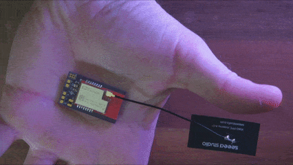
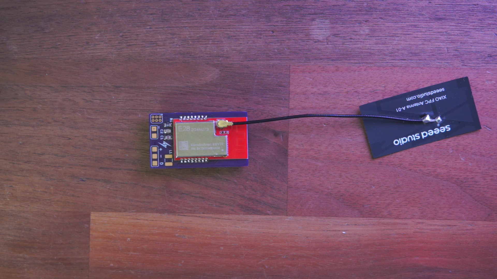
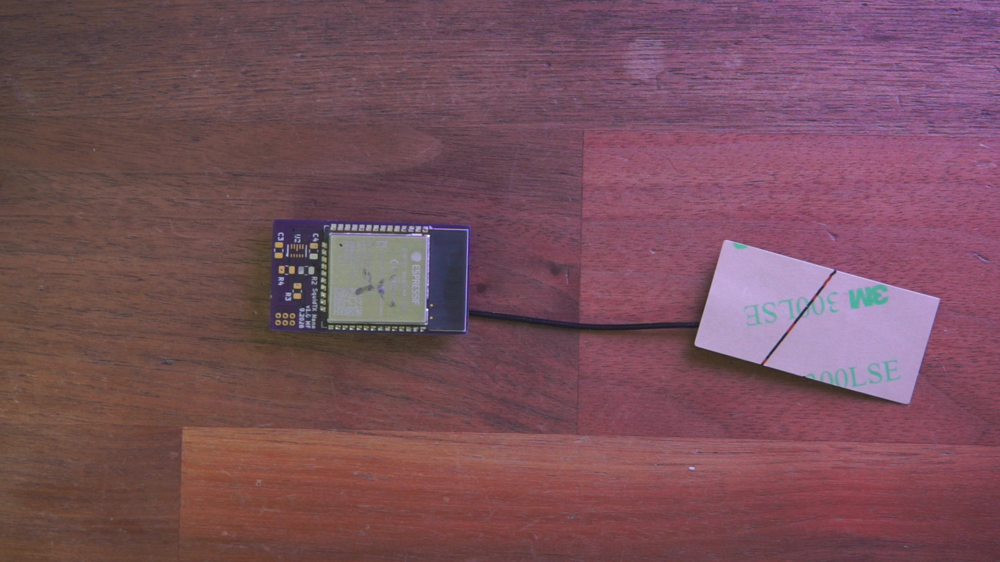
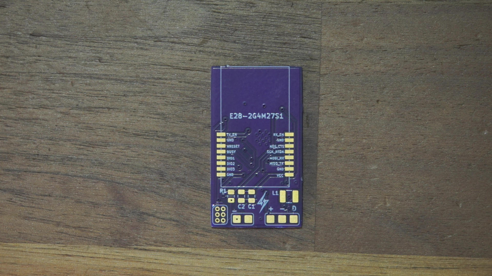
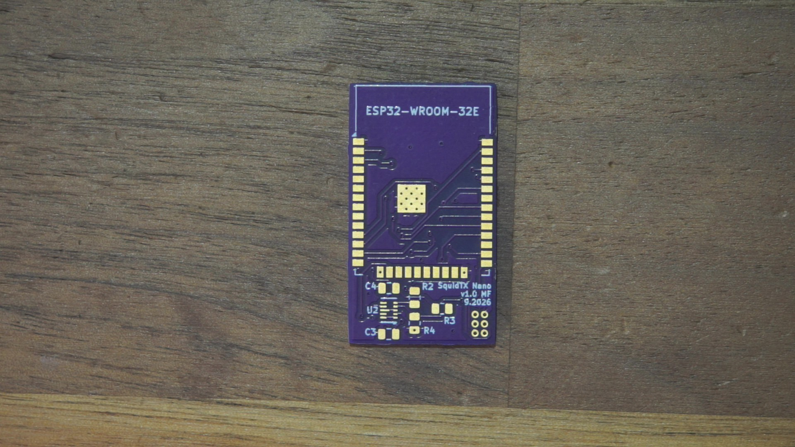
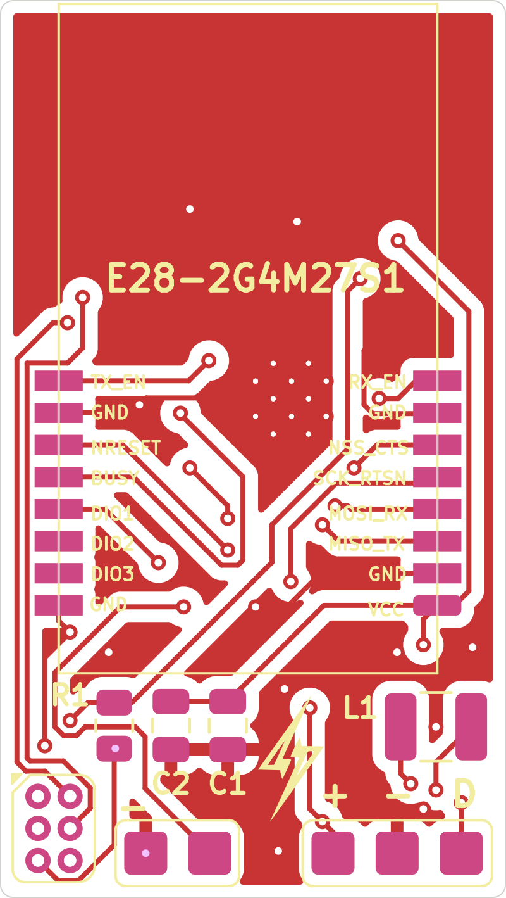
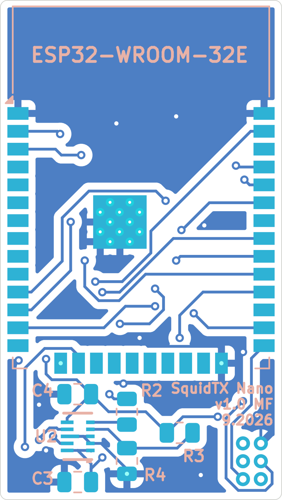

# SquidTX Nano

SquidTX Nano is a small 2.4Ghz ELRS TX board. It features an ESP32-WROOM-32E and an SX1280
and runs the stock ExpressLRS `DIY 2400 E28` target. An onboard TPS63802 buck-boost takes
1.3 V to 5.5 V and makes 3.3 V, so the board runs straight off a 1S battery. I designed
this to fit in a TBS Tango 2, but it'll work with anything.

The KiCad files, gerbers and photos are in this repo so you can build one.

<p align="center">
  
  <br>
  <em>Finished board, with the E28 module and its u.FL antenna</em>
  <br><br>
  
  
  
  
  <br>
  <em>Part-assembled front (E28-2G4M27S and u.FL antenna), part-assembled back (ESP32-WROOM-32E), bare PCB front, bare PCB back</em>
  <br><br>
  
  
  <br>
  <em>Copper and silkscreen: front (E28 side) and back (ESP32 side)</em>
</p>

Full schematic: [docs/images/schematic.png](docs/images/schematic.png).

## Contents

- [Features](#features)
- [Specs](#specs)
- [Pin map](#pin-map)
- [Power](#power)
- [Connectors and wiring](#connectors-and-wiring)
- [Bill of materials](#bill-of-materials)
- [Firmware](#firmware)
- [Flashing](#flashing)
- [Manufacturing](#manufacturing)
- [Repo layout](#repo-layout)
- [License](#license)

## Features

- Runs the stock ExpressLRS `DIY 2400 E28` target.
- E28-2G4M27S does the RF: SX1280, PA and LNA, up to 27 dBm, with the PA and LNA enables driven by
  the firmware on IO26 and IO27.
- TPS63802 buck-boost, 1.3 V to 5.5 V in, 3.3 V out at up to 2 A, so no second regulator is needed.
- 20.0 x 35.5 mm, 2 layers, 1.6 mm FR-4, 0805 passives and a 1210 inductor.
- 6-pin SquidGrip pad array for the first flash and for recovery.
- Optional 2-pin fan header on IO17, which is the target's `misc_fan_en`.

## Specs

| Item | Value |
| --- | --- |
| Protocol | ExpressLRS 2.4 GHz, CRSF over a half-duplex UART |
| RF module | Ebyte E28-2G4M27S (SX1280 with PA and LNA), 2.4 to 2.5 GHz, 27 dBm |
| Antenna | u.FL/IPEX connector on the sx1280 module. I've used an external u.FL antenna in some of the photos |
| MCU | ESP32-WROOM-32E (ESP32-D0WD-V3, 4 MB flash) |
| Firmware target | `DIY 2400 E28`, legacy name `DIY_2400_TX_ESP32_SX1280_E28` |
| Minimum ExpressLRS version | 3.0.0 |
| Input voltage | 1.3 V to 5.5 V |
| Output | 3.3 V, up to 2 A (TPS63802DLAR buck-boost) |
| Power levels | 5, shown as 10 / 25 / 50 / 100 / 250 mW in the Lua script |
| Size | 20.0 x 35.5 mm, 0.5 mm corner radius |
| Connectors | J1 3-pin power and CRSF header, J2 2-pin fan header, SG1 6-pin SquidGrip port |
| LED, screen, button | none |


## Pin map

These are taken from the schematic, and they match the stock `DIY 2400 E28` target pin for pin,
which is why no firmware changes are needed.

### ESP32-WROOM-32E

| ESP32 pin | GPIO | Net name | Connects to | ELRS target key |
| --- | --- | --- | --- | --- |
| 29 | IO5 | `NSS_CTS/IO5` | E28 pin 6 (NSS_CTS) | `radio_nss: 5` |
| 30 | IO18 | `SCK/RTSN/IO18` | E28 pin 5 (SCK_RTSN) | `radio_sck: 18` |
| 31 | IO19 | `MISO_TX/IO19` | E28 pin 3 (MISO_TX) | `radio_miso: 19` |
| 37 | IO23 | `MOSI_RX/IO23` | E28 pin 4 (MOSI_RX) | `radio_mosi: 23` |
| 33 | IO21 | `BUSY/IO21` | E28 pin 12 (BUSY) | `radio_busy: 21` |
| 26 | IO4 | `DIO1/IO4` | E28 pin 13 (DIO1) | `radio_dio1: 4` |
| 13 | IO14 | `RESET/IO14` | E28 pin 11 (NRESET) | `radio_rst: 14` |
| 12 | IO27 | `RX_EN/IO27` | E28 pin 8 (RX_EN, LNA enable) | `power_rxen: 27` |
| 11 | IO26 | `TX_EN/IO26` | E28 pin 9 (TX_EN, PA enable) | `power_txen: 26` |
| 16 | IO13 | `ELRS_DUPLEX` | J1 pin 3 (CRSF) | `serial_rx: 13`, `serial_tx: 13` |
| 28 | IO17 | `FAN_CTRL/IO17` | J2 pin 2 (fan) | `misc_fan_en: 17` |
| 35 | TXD0/IO1 | `TX` | SG1 pin 5 (programmer RXD) | `debug_backpack_tx: 1` |
| 34 | RXD0/IO3 | `RX` | SG1 pin 6 (programmer TXD) | `debug_backpack_rx: 3` |
| 25 | IO0 | `IO0/FLASH` | SG1 pin 4 (programmer RTS) | boot strapping |
| 3 | EN | `EN` | R1 10 kΩ pull-up to 3V3, SG1 pin 2 (DTR) | - |
| 2 | VDD (3V3) | `+3.3V` | U2 VOUT, C1, C2, C4 | - |
| 1, 15, 38, 39 | GND | `GND` | ground plane | - |
| 24 | IO2 | `GND` | tied low (strapping pin) | (`screen_cs: 2`, unused) |

Not connected: `SENSOR_VP/VN`, IO34, IO35, IO32, IO33, IO25, IO12, IO15, IO16, IO22, the SDIO pins
(17 to 22) and NC (32).

### E28-2G4M27S (16 pins, 1.27 mm pitch)

| E28 pin | Name | Net | E28 pin | Name | Net |
| --- | --- | --- | --- | --- | --- |
| 1 | VCC | `+3.3V` | 9 | TX_EN | `TX_EN/IO26` |
| 2 | GND | `GND` | 10 | GND | `GND` |
| 3 | MISO_TX | `MISO_TX/IO19` | 11 | NRESET | `RESET/IO14` |
| 4 | MOSI_RX | `MOSI_RX/IO23` | 12 | BUSY | `BUSY/IO21` |
| 5 | SCK_RTSN | `SCK/RTSN/IO18` | 13 | DIO1 | `DIO1/IO4` |
| 6 | NSS_CTS | `NSS_CTS/IO5` | 14 | DIO2 | not connected |
| 7 | GND | `GND` | 15 | DIO3 | not connected |
| 8 | RX_EN | `RX_EN/IO27` | 16 | GND | `GND` |

## Power

U2 is a TPS63802 buck-boost. It takes the raw battery rail (1.3 V to 5.5 V) and makes the 3.3 V rail
for both modules, so there is no second regulator on the board.

| U2 pin | Name | Net | Notes |
| --- | --- | --- | --- |
| 1 | EN | `VIN/BATT` | tied to VIN, so the converter is always enabled |
| 2 | MODE | `GND` | mode pin tied low |
| 3 | AGND | `GND` | analog ground |
| 4 | FB | feedback divider | see below |
| 5 | PG | `Net-(U2-PG)` | 100 kΩ pull-up to VIN (R2), not routed to the MCU |
| 6 | VOUT | `+3.3V` | output, C4 is 22 µF |
| 7 | L2 | `Net-(U2-L2)` | to L1 |
| 8 | GND | `GND` | power ground |
| 9 | L1 | `Net-(U2-L1)` | to L1 |
| 10 | VIN | `VIN/BATT` | input, C3 is 10 µF |

Output voltage comes from the feedback divider, VOUT = VFB x (1 + R3/R4), and the TPS63802 reference
is 0.5 V:

```
0.5 V x (1 + 56k / 10k) = 3.3 V
```

L1 is 0.47 µH in a 1210 package. Pick one with a saturation current above the TPS63802's switch
current limit, so 2 A or more. The E28 module pulls around 0.6 A at 3.3 V when it is at full power.

C1 (4.7 µF) and C2 (0.1 µF) decouple the 3.3 V rail at the modules. C3 (10 µF) is the converter input
cap and C4 (22 µF) is the output cap.

## Connectors and wiring

| Ref | Type | Pin | Net | Notes |
| --- | --- | --- | --- | --- |
| J1 "INPUTS" | 1x3, 2.54 mm | 1 | `VIN/BATT` | 1.3 V to 5.5 V |
| | | 2 | `GND` | ground |
| | | 3 | `ELRS_DUPLEX` | CRSF to the radio (IO13) |
| J2 "Fan" | 1x2, 2.54 mm | 1 | `GND` | fan negative |
| | | 2 | `FAN_CTRL/IO17` | fan positive, switched by `misc_fan_en` |
| SG1 "SquidGrip" | 2x3, 1.27 mm | 1 | `GND` | programmer ground |
| | | 2 | `EN` | ESP32 reset (programmer DTR) |
| | | 3 | `+3.3V` | 3.3 V out to the programmer |
| | | 4 | `IO0/FLASH` | boot select (programmer RTS) |
| | | 5 | `TX` (IO1) | ESP32 TXD0 to programmer RXD |
| | | 6 | `RX` (IO3) | ESP32 RXD0 to programmer TXD |

J1 is the only connection the module needs: power, ground and the CRSF signal. Wire those three to
whatever radio you are using. J2 is optional, and SG1 is only for flashing.

J1 and J2 are 2.54 mm through-hole headers on the front. SG1 is a 1.27 mm 2x3 pad array that mates
with a SquidGrip probe. The SquidGrip is a USB-UART probe I designed around a CP2102N, with the ESP32
auto-reset circuit on it (DTR to EN, RTS to IO0). It is a thin PCB tongue that clamps onto a bare
board with an alligator clip style grip, and it is a cheap alternative to Tag-Connect. Its design
files are in the [SquidGrip repo](https://github.com/unixvoid/squidgrip), and the pad array on its own
is here as `hardware/squidgrip_pogo_2x03_P1.27mm.kicad_mod`.

## Bill of materials

| Ref | Value / Part | Package | Notes |
| --- | --- | --- | --- |
| U1 | Espressif ESP32-WROOM-32E (4 MB) | module, 18 x 25.5 mm | MCU, WiFi and BT (used for WiFi updates) |
| U2 | TI TPS63802DLAR | 10-pin DLA (VQFN-HR) | buck-boost, 1.3 to 5.5 V in, 3.3 V out, 2 A |
| E28-2G4M27S1 | Ebyte E28-2G4M27S | 16-pin SMD, 1.27 mm pitch, about 15 x 26.5 mm | SX1280 with PA and LNA, 27 dBm. PCB antenna or u.FL, selected by a resistor on the module (this build uses u.FL) |
| L1 | 0.47 µH | 1210 (3225 metric) | 2 A saturation or better |
| C1 | 4.7 µF | 0805 | 3V3 decoupling |
| C2 | 0.1 µF | 0805 | 3V3 decoupling |
| C3 | 10 µF | 0805 | VIN input cap |
| C4 | 22 µF | 0805 | VOUT output cap |
| R1 | 10 kΩ | 0805 | ESP32 EN pull-up to 3V3 |
| R2 | 100 kΩ | 0805 | PG pull-up to VIN |
| R3 | 56 kΩ | 0805 | feedback divider, top |
| R4 | 10 kΩ | 0805 | feedback divider, bottom |
| - | 2.4 GHz antenna and u.FL pigtail | external | not on the PCB. The E28 needs an antenna on its u.FL (this build uses a Seeed Studio XIAO FPC Antenna A-01) |

## Firmware

This board runs a stock ExpressLRS target. There is no custom target and no `user_defines` to set.

| | |
| --- | --- |
| Target in the Configurator | DIY ESP32 E28 2.4GHz TX (vendor: DIY) |
| Unified target name | `DIY 2400 E28` |
| Legacy target name | `DIY_2400_TX_ESP32_SX1280_E28` |
| Firmware binary | `Unified_ESP32_2400_TX` |
| Minimum ELRS version | 3.0.0 |
| Upload methods | UART, WiFi |
| Target features | fan |

The target's pins match this board, including the half-duplex CRSF line on IO13, the PA and LNA
enables on IO26 and IO27, and the fan output on IO17.

A few target settings go unused here: `led_rgb` (IO15), the screen pins (2, 22, 32, 33, 16),
`power_lna_gain` (IO12) and the ESP backpack.

## Flashing

### First flash over UART

Use a SquidGrip if you have one, otherwise any 3.3 V USB-UART adapter (CP2102, FT232, CH340 and so
on) wired to SG1:

| USB-UART adapter | SG1 pin | Notes |
| --- | --- | --- |
| GND | 1 | required |
| DTR | 2 | ESP32 EN (reset) |
| 3V3 | 3 | optional, the board can also be powered from J1 |
| RTS | 4 | ESP32 IO0 (boot select) |
| RXD | 5 | to the ESP32's TX (IO1) |
| TXD | 6 | to the ESP32's RX (IO3) |

Then pick the target above in the Configurator, set the upload method to UART, choose the COM port
and press Build & Flash.

The board wires DTR straight to EN and RTS straight to IO0. The auto-reset logic lives in the
SquidGrip (or in whatever programmer you use), not on the board, so a plain adapter without that
circuit may not reset the ESP32 on its own. If that happens, put it into boot mode by hand: hold
IO0 (SG1 pin 4) to GND, pulse EN (SG1 pin 2) to GND, release IO0, then start the flash.

### Updates over WiFi

ESP32 targets can be flashed over WiFi, so after the first UART flash you do not have to take
anything apart:

1. In the radio's ELRS Lua script, start the WiFi update. The module reboots into access point mode.
2. Join its network (the ELRS defaults are SSID `ExpressLRS TX` and password `expresslrs`).
3. Use the Configurator's WiFi method, or open `http://10.0.0.1` and use the web UI.

### Binding

There is no bind button on the board, so bind from the ELRS Lua script. The Lua script is also where
you read link status, since there is no status LED either.

## Manufacturing

Everything you need to order the board is in `hardware/`:

| File | Description |
| --- | --- |
| `hardware/squidtx_nano.kicad_pro` | KiCad project (design rules and netclass) |
| `hardware/squidtx_nano.kicad_sch` | schematic (title block: SquidTX Nano, rev v1, Midnight CAD) |
| `hardware/squidtx_nano.kicad_pcb` | PCB layout |
| `hardware/manufacturing/squidtx_nano-v1-gerbers.zip` | gerber and drill package, ready to upload |
| `hardware/manufacturing/gerbers/` | the same files unpacked (F and B Cu, mask, paste, silk, Edge_Cuts, drill, job) |
| `hardware/squidgrip_pogo_2x03_P1.27mm.kicad_mod` | the 6-pin SquidGrip pad array on its own, for your own boards |
| `docs/images/` | photos, renders and the schematic image used here |


## Repo layout

```
.
├── README.md
├── LICENSE                      # CERN-OHL-S-2.0
├── docs/
│   └── images/
│       ├── squidtx_nano.gif            # gif, finished board in hand
│       ├── squidtx_nano_front.jpg      # photo, board front (E28 side)
│       ├── squidtx_nano_back.jpg       # photo, board back (ESP32 side)
│       ├── squidtx_nano_pcb_front.jpg  # photo, bare PCB front
│       ├── squidtx_nano_pcb_back.jpg   # photo, bare PCB back
│       ├── board-front.png             # KiCad render, front copper and silk
│       ├── board-back.png              # KiCad render, back copper and silk
│       └── schematic.png               # schematic image
└── hardware/
    ├── squidtx_nano.kicad_pro   # KiCad project
    ├── squidtx_nano.kicad_sch   # schematic
    ├── squidtx_nano.kicad_pcb   # PCB layout
    ├── squidgrip_pogo_2x03_P1.27mm.kicad_mod   # the 6-pin SquidGrip pad array
    └── manufacturing/
        ├── squidtx_nano-v1-gerbers.zip
        └── gerbers/             # unpacked gerbers and drill files
```

## License

SquidTX Nano is licensed under the CERN Open Hardware Licence Version 2 - Strongly Reciprocal
(CERN-OHL-S-2.0). The full licence text is in [`LICENSE`](LICENSE).

```
Copyright (C) 2026 Midnight CAD / SquidTX

This source describes Open Hardware and is licensed under the CERN-OHL-S v2.

You may redistribute and modify this source and make products using it under
the terms of the CERN-OHL-S v2 (https://ohwr.org/cern_ohl_s_v2.txt).

This source is distributed WITHOUT ANY EXPRESS OR IMPLIED WARRANTY, INCLUDING
OF MERCHANTABILITY, SATISFACTORY QUALITY AND FITNESS FOR A PARTICULAR PURPOSE.
Please see the CERN-OHL-S v2 for applicable conditions.

Source location: https://github.com/unixvoid/SquidTX-Nano-ELRS
```